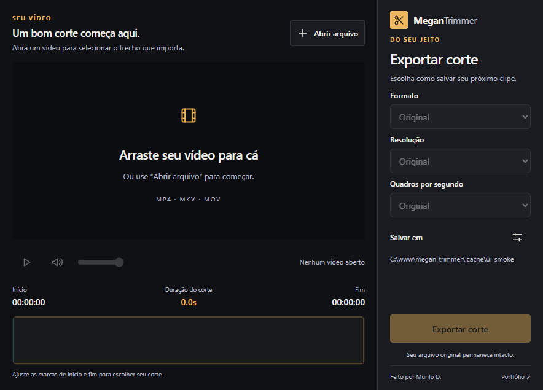
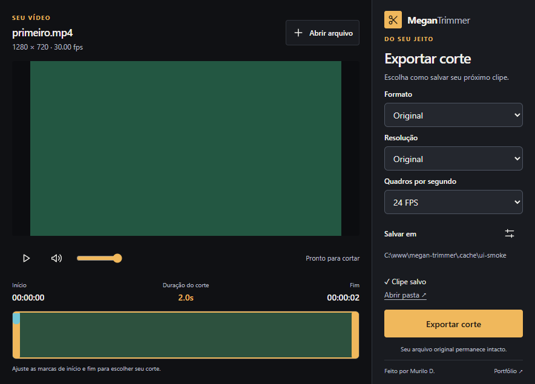

<p align="center">
  
</p>

<h1 align="center">MeganTrimmer</h1>

<p align="center">Corte vídeos e converta arquivos em uma interface simples.</p>

<p align="center">
  
  
  
</p>

<p align="center">
  <a href="https://github.com/self1027/megan-trimmer/releases">Baixar para Windows</a> ·
  <a href="#como-usar">Como usar</a> ·
  <a href="https://github.com/self1027/megan-trimmer/issues">Relatar um problema</a>
</p>

O MeganTrimmer é para quando você quer tirar um trecho de um vídeo ou mudar seu formato. A prévia, a seleção do corte e as opções de exportação ficam na mesma tela, para você acompanhar o que está fazendo até salvar o arquivo.

A proposta é manter o aplicativo simples, sem bloatware, com manutenção e foco nas tarefas do dia a dia.

## Por dentro do app

Abra um arquivo ou arraste seu vídeo para a janela.



Escolha o trecho na linha do tempo e salve. O aviso de conclusão permite abrir a pasta do clipe.



*As capturas usam um vídeo de teste com fundo verde.*

## O que dá para fazer

- Cortar um vídeo escolhendo o início e o fim na linha do tempo.
- Converter vídeos para MP4, MKV ou AVI, ou extrair o áudio em MP3 e WAV.
- Manter o formato original ou ajustar a resolução e os quadros por segundo.
- Escolher onde salvar os clipes. O aplicativo lembra a pasta na próxima vez.
- Preservar o arquivo original. Se o nome de saída já existir, o novo clipe recebe outro nome.

O processamento acontece no seu computador, com o FFmpeg já incluído no aplicativo.

## Como usar

Baixe a versão para Windows na página de [Releases](https://github.com/self1027/megan-trimmer/releases). Escolha **Setup.exe** para instalar com atualizações pelo aplicativo ou **Portable.exe** para abrir sem instalar.

Quando há uma versão nova, o aplicativo pede uma escolha antes de liberar o editor: **Atualizar agora** ou **Continuar sem atualizar**. O aviso também tem um link para as novidades no GitHub Releases. Escolher continuar não baixa nem instala a atualização; você pode reconsiderar pelo botão **Atualizações**. Exportações em andamento impedem o reinício, e alterações não exportadas exigem confirmação antes de fechar.

Se já usa uma versão antiga, execute o novo **Setup.exe** uma vez: ele reconhece a instalação anterior, inclusive a feita pelo MSI, e mantém suas configurações. No portátil, feche o aplicativo e substitua o arquivo manualmente.

1. Clique em **Abrir arquivo** ou arraste um vídeo para o app.
2. Ajuste as marcas de início e fim para selecionar o trecho.
3. Escolha o formato e a pasta de destino.
4. Clique em **Exportar corte**.

Para converter o vídeo inteiro, mantenha a seleção do começo ao fim e escolha o formato de saída.

## Acompanhe o projeto

Encontrou um problema ou sentiu falta de alguma coisa? [Abra uma issue](https://github.com/self1027/megan-trimmer/issues) contando o que aconteceu ou o que você gostaria de fazer.

<details>
<summary>Para rodar o projeto localmente</summary>

Você precisa de Node.js 22.12 ou superior. Na pasta do projeto:

```bash
npm install
npm run dev
```

Para executar os testes, use `npm test` e `npm run test:ui`. `npm run dist` gera o instalador EXE, o portátil e o manifesto de atualização. Depois do build, `npm run test:package` confere os binários incluídos e `npm run test:update-feed` testa download e integridade em um servidor local, sem instalar nada.

A publicação acontece no GitHub Actions ao enviar uma tag `vX.Y.Z`. Veja o [procedimento de release](docs/releases.md), incluindo a validação inicial de instalação e migração.

</details>

---

Feito por [Murilo D.](https://murilod.dev/) · [LinkedIn](https://www.linkedin.com/in/murilo-dias-dev/) · [GitHub](https://github.com/self1027) · Licença ISC
